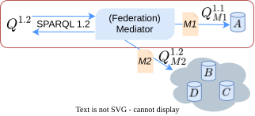

## Query rewriting
{:#technique}
<figure id="architecture">
    
<figcaption markdown="block">
A SPARQL 1.2 query $$Q^{1.2}$$ enters the Federation Mediator, which rewrites it through user-authored mappings.
The red box highlights the reification interoperability use-case: mapping $$M1$$ rewrites the query into $$Q^{1.1}_{M1}$$ against a single legacy source $$A$$ that uses an established reification pattern.
The full figure depicts the general setting: $$M2$$ is a GAV mapping spanning multiple sources $$B$$, $$C$$, $$D$$, producing a federated query $$Q^{1.2}_{M2}$$.
Each mapping is itself a SPARQL CONSTRUCT query;
the mediator unfolds them into $$Q^{1.2}$$ and the rewritten query runs on any standards-compliant SPARQL 1.2 federation engine.
</figcaption>
</figure>

 gives an overview of our approach: a user query is
sent to a federation mediator, which rewrites it through one or more
user-authored mappings into queries against the sources. We express
each mapping as a SPARQL CONSTRUCT query: the template (mapping head)
states what the mapping asserts about the global, and the `WHERE`
clause (mapping body) queries the source. 
When several mappings target the same global, their outputs are implicitly unioned,
in line with RDF's [dataset merge operation](cite:cites spec:rdf-semantics-1-2).
 shows two such mappings: one constructs triple terms from
rdf-reification statements in the source, the other passes source
triples through unchanged. When a CONSTRUCT template contains
multiple triple patterns, we split it into one rule per triple pattern
and combine them through a `UNION` in the `WHERE` clause;
 shows the equivalent single-headed form.

**Algorithm.**  The rewriting algorithm unfolds each triple pattern in
the user query against any mapping whose template (mapping head)
matches it, pushing additional constraints from the pattern into the
`WHERE` clause of the matching mapping.
Consider the user query in , which asks for triple terms whose inner predicate is
`rdf:type` together with a confidence score above `0.8`.
The first triple pattern fixes the predicate to `rdf:reifies` and the inner
predicate of the triple term to `rdf:type`; these constants flow into
the unfolded body, replacing `?p` by `rdf:type` in .
Mappings whose template cannot match a pattern -- for instance because the predicates are incompatible -- contribute a
`FILTER(FALSE)` branch, which a downstream optimizer can prune.

<figure id="mapping">
<pre><code># Create a mapping from rdf reification to triple terms
CONSTRUCT { ?t rdf:reifies <<( ?s ?p ?o )>> }
WHERE {
  ?t a rdf:Statement ; rdf:Subject ?s ;
     rdf:Predicate ?p ; rdf:Object ?o ; 
} # and copy all triples
CONSTRUCT { ?s ?p ?o } WHERE {
  ?s ?p ?o .
}</code></pre>
<figcaption markdown="block">
Two mappings:
one constructs triple terms in the global,
the other passes source triples through unchanged.
</figcaption>
</figure>

<figure id="mapping-as-one">
<pre><code>CONSTRUCT { ?s ?p ?o } WHERE {
  { ?m_t a rdf:Statement ;
       rdf:Subject ?m_s ;
       rdf:Predicate ?m_p ;
       rdf:Object ?m_o .
    BIND(?m_t as ?s) .
    BIND(rdf:reifies as ?p) .
    BIND(triple(?m_s, ?m_p, ?m_o) as ?o). }
  UNION
  { ?s ?p ?o }
}</code></pre>
<figcaption markdown="block">
The same global as , expressed as a single CONSTRUCT in accordance with .
</figcaption>
</figure>

<figure id="user-query">
<pre><code>SELECT * WHERE {
  ?t rdf:reifies <<( ?s rdf:type ?o )>> ;
     ex:confidence ?score .
  FILTER(?score > 0.8)
}</code></pre>
<figcaption markdown="block">
Example user query: triple terms asserting `rdf:type` with a confidence score above 0.8.
</figcaption>
</figure>

<figure id="rewritten-query">
<pre><code>SELECT ?score ?o ?s ?t WHERE {
  { ?t rdf:type rdf:Statement ; rdf:Subject ?s ;
       rdf:Predicate rdf:type ; rdf:Object ?o . }
  UNION { # Assume 1.1 sources -> no triple terms
    FILTER ( FALSE ) }
  { # Predicate rdf:reifies does not match ex:confidence
    FILTER ( FALSE ) }
  UNION { ?t ex:confidence ?score }
  FILTER ( ?score &gt; 0.8 )
}</code></pre>
<figcaption markdown="block">
Cleaned-up version (for readability) of the query in  rewritten against the mapping in .
The rewritten query no longer asks the source for triple terms; instead it expresses the same intent through the reification scheme used by the source.
</figcaption>
</figure>

**Scope.** 
Although this paper focuses on RDF 1.2 interoperability,
the rewriting framework is more general: we envision it as a broader
approach to SPARQL query answering under mappings, of which
reification-pattern translation is one application.
Because the rewritten query is itself a federated SPARQL query, the
approach inherits the boundaries of federated SPARQL.  Blank nodes
have limited support on both sides of a mapping: CONSTRUCT templates
and the `BNODE` expression introduce fresh blank nodes scoped to a
single query solution, and blank nodes returned by a source cannot be
matched across invocations of the same endpoint, since [blank nodes
are scoped to the document or result set in which they are
serialized](cite:cites sparql-1-2).  Skolemization is the classical
solution.  Recursive property paths (`*` and `+`) are likewise not
handled, pending a recursive extension to SPARQL.
