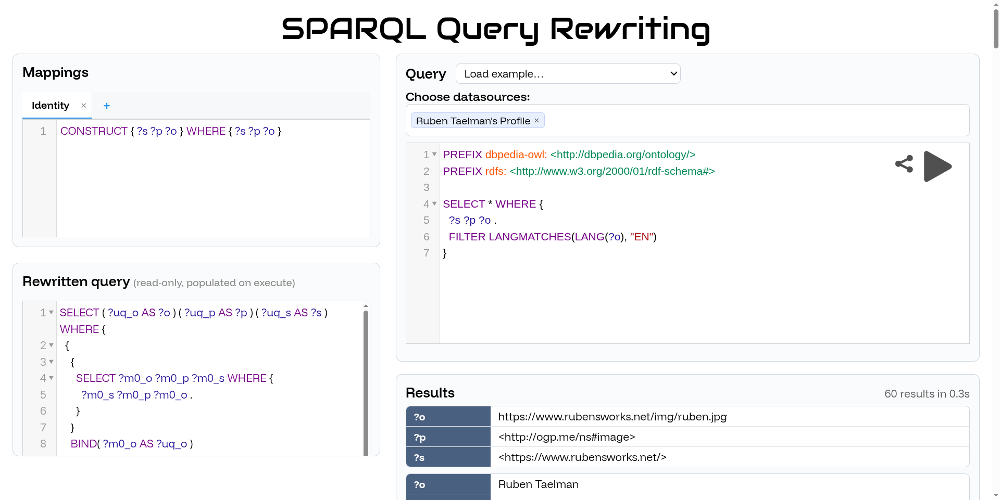

## Demonstration
{:#demo}

The demo's main scenario is RDF 1.2 interoperability: the user
writes a SPARQL 1.2 query using triple terms, points it at one or more
sources that model statement-level metadata through legacy reification
patterns, and sees the query rewritten so that it runs against the
sources as-is.  The rewritten query is shown alongside the original so
users can inspect the rewriting.  Alongside this main scenario, the
demo ships with several preset scenarios that exercise different
facets of the framework: *TODO-preset-1*, *TODO-preset-2*, and
*TODO-preset-3*.

The same mechanism is not limited to reification translation.  Any
mapping the user writes becomes part of the global schema, and the
rewriting handles it identically.  Federation across sources is itself
a special case: selecting a set of endpoints is equivalent to a second
layer of GAV rewriting in which every mapping has the form `CONSTRUCT
{ ?s ?p ?o } WHERE { SERVICE <s> { ?s ?p ?o } }`, which the engine
performs as [exhaustive source selection](cite:cites
heterogeneous_fedqpl).  The demo thus stands in for a broader claim
from : that mapping-driven query rewriting is a general
way to query RDF under user-defined schemas, with reification
interoperability as one application.

The interface exposes this through four panels.
The _mappings panel_ (top left) is where the user writes CONSTRUCT queries that together define the global schema.
The _query panel_ (top right) is where the user selects sources and writes the user query against that schema.
The _rewritten query panel_ (bottom left) is read-only and shows the user query unfolded against the mappings after execution.
The _results panel_ (bottom right) reports elapsed execution time, the result count, and the streaming bindings as they arrive.

<!-- The demo lets users issue federated queries over sources of their -->
<!-- choice, against a global schema that they define through their own -->
<!-- mappings.  The interface consists of four panels. -->

<!-- The _mappings panel_ (top left) is where users manage the CONSTRUCT -->
<!-- queries that together define the global schema.  Formally, a GAV -->
<!-- mapping is a single CONSTRUCT (see ); the UI lets users -->
<!-- write multiple mappings whose outputs are implicitly unioned. -->

<!-- The _query panel_ (top right) is where users select sources and write -->
<!-- the query.  With no sources selected, the rewritten query can still -->
<!-- return results when the mappings include SERVICE calls.  When many -->
<!-- sources are selected, the federation engine performs [exhaustive -->
<!-- source selection](cite:cites heterogeneous_fedqpl), which can itself -->
<!-- be viewed as a second GAV rewriting in which every mapping has the -->
<!-- form `CONSTRUCT { ?s ?p ?o } WHERE { SERVICE <serviceA> { ?s ?p ?o } -->
<!-- }`.  The panel also offers preset scenarios: -->
<!-- 1. trustworthiness using RDF 1.2, -->
<!-- 2. exhaustive source selection, and -->
<!-- 3. spam-filter. -->

<!-- The _rewritten query panel_ (bottom left) is read-only; after -->
<!-- execution it shows the user query unfolded against the mappings. -->

<!-- The _results panel_ (bottom right) reports elapsed execution time, the -->
<!-- result count, and the streaming bindings as they arrive. -->

<figure id="screenshot" style="display: flex; flex-direction: column">

<figcaption markdown="block">
Screenshot of the web interface:
a user query is rewritten against user-defined mappings and executed over the chosen sources.
</figcaption>
</figure>
